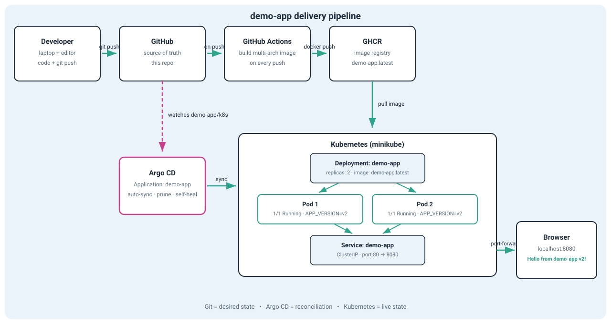

# Kubernetes CI/CD & GitOps Starter Kit

A complete, reproducible DevOps playground. Clone the repo, run one script, and get a full CI/CD pipeline with GitOps delivery to Kubernetes — then break things on purpose and learn to fix them the GitOps way.

## What you get

- **Demo app** — a small Flask application, containerized with Docker (multi-arch: `linux/amd64` + `linux/arm64`, so it runs on Intel and Apple Silicon)
- **CI** — GitHub Actions builds the image on every push to `main` and publishes it to GitHub Container Registry (GHCR)
- **CD** — Argo CD watches the `demo-app/k8s` folder in this repo and syncs it to Kubernetes automatically (prune + self-heal enabled)
- **Troubleshooting scenarios** — four hands-on incidents: config drift, broken image rollback, prune on delete, misconfigured source path
- **One-command setup and teardown** — `./setup.sh` brings everything up, `./cleanup.sh` removes it cleanly

## Architecture



The flow: you push code → GitHub Actions builds a Docker image → the image lands in GHCR → Argo CD notices the change in Git and syncs the Kubernetes cluster → two pods serve the app behind a ClusterIP Service.

The key GitOps idea: **Git is the single source of truth.** Argo CD continuously reconciles the live cluster state with what Git declares. Any manual change in the cluster gets reverted automatically.

## Repository structure

```
├── README.md              # you are here
├── setup.sh               # one command: installs Argo CD, deploys the app
├── cleanup.sh             # one command: removes the app and Argo CD
├── demo-app/              # the application
│   ├── README.md          # app-level guide: endpoints, local run, roadmap
│   ├── app.py             # Flask app (/ and /health)
│   ├── Dockerfile         # multi-stage, python:3.12-slim
│   ├── run.sh / stop.sh   # one-command local run with Docker
│   └── k8s/               # Kubernetes manifests — Argo CD's source of truth
│       ├── deployment.yaml
│       └── service.yaml
├── .github/workflows/     # CI pipeline: build multi-arch image → push to GHCR
│   └── docker-build-push.yml
├── argocd-app.yaml        # Argo CD Application definition
└── troubleshooting/       # incident scenarios, step by step
    ├── 01-drift-and-self-heal.md
    ├── 02-broken-image-rollback.md
    ├── 03-prune-on-delete.md
    └── 04-wrong-source-path.md
```

## Prerequisites

- [Git](https://git-scm.com/downloads)
- [Docker](https://docs.docker.com/get-docker/) (Docker Desktop is fine)
- [`kubectl`](https://kubernetes.io/docs/tasks/tools/)
- A local Kubernetes cluster: [minikube](https://minikube.sigs.k8s.io/docs/start/), kind, or Docker Desktop Kubernetes
- A GitHub account (only needed for the CI part — the local flow works without it)

Checklist before you start:

```bash
git --version
docker --version
kubectl version --client
kubectl get nodes   # at least one node must be Ready
```

## Quick start

```bash
git clone https://github.com/olessya2907/argocd-test.git
cd argocd-test
./setup.sh
```

What `setup.sh` does:

1. Verifies `kubectl` can reach your cluster.
2. Installs Argo CD into the `argocd` namespace and waits until it is ready.
3. Applies `argocd-app.yaml`, registering the demo app with Argo CD.
4. Waits for the app pods to become `Running`.
5. Starts a port-forward so you can open the app.

Then open http://localhost:8080 — you should see:

```
Hello from demo-app v1!
```

## How it works, step by step

1. **Code** — the app lives in `demo-app/`. Two routes: `/` returns a greeting with the current `APP_VERSION`, `/health` returns JSON for Kubernetes probes.
2. **Push** — `git push` to `main`. The workflow triggers only when files under `demo-app/` change.
3. **CI** — GitHub Actions (`.github/workflows/docker-build-push.yml`):
   - checks out the code,
   - sets up Docker Buildx,
   - logs in to GHCR with the built-in `GITHUB_TOKEN`,
   - builds a **multi-arch** image (`linux/amd64`, `linux/arm64`) and pushes `ghcr.io/<owner>/demo-app:latest`.
4. **CD** — the Argo CD Application (`argocd-app.yaml`) watches `demo-app/k8s` on the `main` branch. On every detected change it syncs automatically. `prune: true` removes resources deleted from Git; `selfHeal: true` reverts manual cluster edits.
5. **Run** — the Deployment runs 2 replicas. Liveness and readiness probes hit `/health`, so broken pods get restarted and new versions roll out safely.
6. **Verify** — `kubectl port-forward svc/demo-app 8080:80`, then open http://localhost:8080.

## Try it: ship v2 through Git

The whole point of the kit in one exercise:

```bash
# 1. Bump the version in demo-app/k8s/deployment.yaml:
#    value: "v1"  →  value: "v2"

# 2. Commit and push
git add demo-app/k8s/deployment.yaml
git commit -m "feat: deploy demo-app v2"
git push

# 3. Watch the rolling update — no kubectl apply needed
kubectl get pods -w
```

Refresh http://localhost:8080 → `Hello from demo-app v2!`. One line in Git, zero manual cluster commands: that is continuous delivery.

## Troubleshooting scenarios

Each scenario in `troubleshooting/` follows the same pattern: break it → observe the symptoms → diagnose with evidence → fix the source of truth (Git) → verify recovery.

| # | Scenario | What breaks | What you learn |
|---|----------|-------------|----------------|
| 01 | Drift and self-heal | `kubectl scale deployment demo-app --replicas=5` | Desired vs live state; why the change disappears |
| 02 | Broken image rollback | Image tag that does not exist | `Synced` ≠ `Healthy`; reading pod events; `git revert` as the fix |
| 03 | Prune on delete | Manifest removed from Git | How `prune: true` keeps the cluster clean |
| 04 | Wrong source path | Typo in the Application `path` | Diagnosing sync failures: repo access vs manifest vs runtime |

## Cleanup

```bash
./cleanup.sh
```

Removes the Argo CD Application, the demo app resources, and — on confirmation — Argo CD itself. Your cluster is left clean.

## Tech stack

Docker · Kubernetes (minikube) · Argo CD · GitHub Actions · GHCR · Bash · Python (Flask) · YAML
